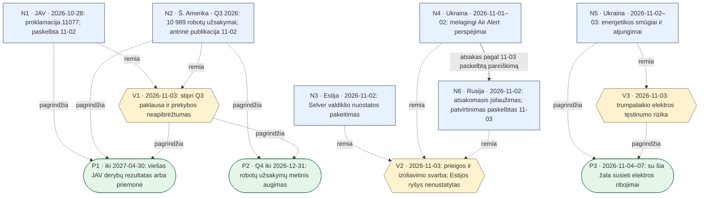

# Datuotų įvykių žemėlapis

Šeši konkretūs įvykiai / duomenų taškai (N), atskiri analitiko vertinimai (V) ir datuotos prognozės (P). Punktyrinė rodyklė reiškia „remia vertinimą“ arba „pagrindžia prognozę“, o ne „sukėlė“. Vienintelė ištisinė įvykių jungtis N4 → N6 reiškia viešai pripažintą atsaką pagal Zelenskio pareiškimą. Ji nesuteikia nepriklausomo techninio priskyrimo. Estijos incidentas neturi jungties į Ukrainos ar Rusijos ataką.

## Taškai: alternatyva be Mermaid

| ID | Data / horizontas | Konkretus taškas |
|---|---|---|
| N1 | 2026-10-28 | [JAV pradėjo robotikos importo derybas, bet nenustatė naujo muito](../suvestines/2026-11-03-naujienos.md#n1) |
| N2 | 2026-07-01/2026-09-30 | [Šiaurės Amerikos Q3 robotų užsakymai augo 24,8 procento](../suvestines/2026-11-03-naujienos.md#n2) |
| N3 | 2026-11-02 | [Estijoje pakeista šaldiklio nuostata, bet produktai nenukentėjo](../suvestines/2026-11-03-naujienos.md#n3) |
| N4 | 2026-11-01/2026-11-02 | [Ukrainos „Air Alert“ siuntė melagingus pavojaus pranešimus](../suvestines/2026-11-03-naujienos.md#n4) |
| N5 | 2026-11-02/2026-11-03 | [Smūgiai Ukrainos energetikai sukėlė avarinius atjungimus](../suvestines/2026-11-03-naujienos.md#n5) |
| N6 | 2026-11-02 | [Zelenskis patvirtino atsakomąjį įsilaužimą į Rusijos perspėjimų sistemą](../suvestines/2026-11-03-naujienos.md#n6) |
| V1 | 2026-11-03 | [Robotikos paklausa stipri, prekybos sąlygos neapibrėžtos](../prognozes/2026-11-03-vertinimai-ir-prognozes.md#v1) |
| V2 | 2026-11-03 | [Greitas izoliavimas riboja žalą, bet prieigos rizika išlieka](../prognozes/2026-11-03-vertinimai-ir-prognozes.md#v2) |
| V3 | 2026-11-03 | [Elektros tęstinumas priklauso nuo pažeidimų ir tinklo apsaugos](../prognozes/2026-11-03-vertinimai-ir-prognozes.md#v3) |
| P1 | 2026-11-04–2027-04-30, iki 23:59 Europe/Vilnius | [Pasirodys viešas robotikos importo derybų rezultatas arba priemonė](../prognozes/2026-11-03-vertinimai-ir-prognozes.md#p1) |
| P2 | 2026-10-01–2026-12-31; vertinimas 2027-03-31 | [Q4 robotų užsakymų skaičius viršys ankstesnių metų Q4](../prognozes/2026-11-03-vertinimai-ir-prognozes.md#p2) |
| P3 | 2026-11-04 00:00–2026-11-07 23:59 Europe/Kyiv | [Po lapkričio 3 d. išliks su šia žala susietų elektros ribojimų](../prognozes/2026-11-03-vertinimai-ir-prognozes.md#p3) |

## Jungtys

| Iš | Į | Reikšmė |
|---|---|---|
| [N1](#n1) | [V1](#v1) | Įvykis remia vertinimą; tai savaime nėra priežastingumas. |
| [N2](#n2) | [V1](#v1) | Įvykis remia vertinimą; tai savaime nėra priežastingumas. |
| [N3](#n3) | [V2](#v2) | Įvykis remia vertinimą; tai savaime nėra priežastingumas. |
| [N4](#n4) | [V2](#v2) | Įvykis remia vertinimą; tai savaime nėra priežastingumas. |
| [N6](#n6) | [V2](#v2) | Įvykis remia vertinimą; tai savaime nėra priežastingumas. |
| [N5](#n5) | [V3](#v3) | Įvykis remia vertinimą; tai savaime nėra priežastingumas. |
| [N1](#n1) | [P1](#p1) | Prognozės faktinis arba analitinis pagrindas. |
| [N2](#n2) | [P1](#p1) | Prognozės faktinis arba analitinis pagrindas. |
| [V1](#v1) | [P1](#p1) | Prognozės faktinis arba analitinis pagrindas. |
| [N2](#n2) | [P2](#p2) | Prognozės faktinis arba analitinis pagrindas. |
| [V1](#v1) | [P2](#p2) | Prognozės faktinis arba analitinis pagrindas. |
| [N5](#n5) | [P3](#p3) | Prognozės faktinis arba analitinis pagrindas. |
| [V3](#v3) | [P3](#p3) | Prognozės faktinis arba analitinis pagrindas. |
| [N4](#n4) | [N6](#n6) | Atsakas pagal Zelenskio viešą patvirtinimą, paskelbtą 2026-11-03; ne nepriklausomas pirminės atakos techninis priskyrimas. |
